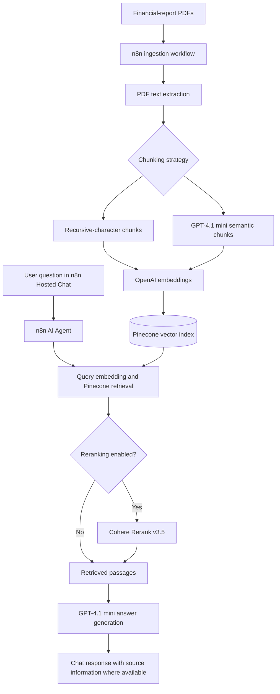

# FinanceBench Financial Document Intelligence — RAG Project

A no-code/low-code **Retrieval-Augmented Generation (RAG)** application for answering financial questions grounded in SEC filings. The project uses **n8n**, **OpenAI**, and **Pinecone**, and investigates how **fixed-size versus LLM-assisted semantic chunking** and optional **Cohere reranking** affect retrieval and answer quality.

> **Project status:** Working prototype with locally tested n8n Hosted Chat and initial retrieval experiments. Results below are exploratory; they are not a comprehensive benchmark or a production-readiness assessment.

## 1. Business problem and objectives

Financial analysts and investors often need to find specific metrics in lengthy SEC filings. The application allows users to ask natural-language questions about financial reports and receive answers based on retrieved passages rather than relying solely on a language model's prior knowledge.

Objectives:

- Answer questions across multiple financial documents.
- Compare fixed-size and semantic chunking approaches.
- Evaluate response accuracy and retrieval quality with FinanceBench-style questions.
- Assess whether reranking improves evidence relevance.
- Offer an accessible chat experience without custom frontend development.

## 2. Technology stack

| Component | Technology | Purpose |
| --- | --- | --- |
| Workflow orchestration and chat | n8n (Hosted Chat) | PDF ingestion, retrieval orchestration, and user interface |
| Generation and semantic segmentation | OpenAI GPT-4.1 mini | Answer generation and LLM-assisted chunking |
| Embeddings | OpenAI `text-embedding-3-small` | 1,536-dimensional text embeddings |
| Vector database | Pinecone | Store and search document vectors |
| Optional reranking | Cohere Rerank v3.5 | Reorder retrieved passages by relevance |
| Local runtime | Docker Desktop | Host local n8n environment |

## 3. Document corpus

The project uses financial reports from the **FinanceBench** benchmark, which is based on publicly available company filings.

| Company | Document |
| --- | --- |
| 3M | FY2018 Form 10-K |
| American Express | FY2022 Form 10-K |

**Data freshness:** This is a batch-ingestion prototype. Answers are limited to the documents and fiscal years actually ingested; new filings are not discovered or loaded automatically.

## 4. Architecture



Ingestion and question answering run as **separate n8n workflows**. Each query searches the already-populated vector database; it does not reprocess PDF documents.

## 5. Document ingestion and preparation

1. Manually execute the ingestion workflow in n8n.
2. Read financial-report PDF files from a local directory.
3. Extract the text and prepare it for segmentation.
4. Attach metadata identifying company, fiscal year, source document, and chunking strategy.
5. Generate embeddings and store vectors and metadata in Pinecone.

The current extraction flow does **not** implement advanced table reconstruction, systematic header/footer removal, or comprehensive text-quality checks. These gaps matter for structured financial statements.

## 6. Chunking experiments

Two strategies were implemented:

| Setting | Fixed-size chunking | LLM-assisted semantic chunking |
| --- | --- | --- |
| Method | Recursive Character Text Splitter | GPT-4.1 mini topic-oriented segmentation |
| Input / chunk configuration | 2,000-character chunks, 300-character overlap | Text processed in approximately 6,000-character batches before segmentation |
| Goal | Simple, consistent segmentation | Better preservation of topic-specific financial context |
| Pinecone namespace | `fixed-size` | `semantic` |

Both strategies use `text-embedding-3-small` to create **1,536-dimensional** vectors in the Pinecone index **`finance-bench-rank`**.

The project documentation recorded approximately **937 vectors** in `fixed-size` and **958 vectors** in `semantic`. The semantic namespace includes earlier experimental records, and some 3M processing encountered structured-output failures. **These totals are not a clean, fully validated chunk-count comparison.**

## 7. Retrieval and answer generation

1. A user asks a question in n8n Hosted Chat.
2. The n8n AI Agent invokes the Pinecone retrieval tool.
3. The question is embedded with the same OpenAI embedding model used at ingestion.
4. Pinecone searches a selected namespace for semantically similar passages.
5. When enabled, **Cohere Rerank v3.5** reranks the candidates; the documented configuration retains the **top five** reranked passages.
6. **GPT-4.1 mini** generates an answer from retrieved context and identifies supporting source information where available.
7. Hosted Chat displays the response.

The experiments included fixed-size and semantic namespaces **with and without reranking**.

## 8. Evaluation and observations

The initial tests focused on whether the system could retrieve relevant financial facts and produce appropriate responses.

| Test area | Documented observation | Interpretation |
| --- | --- | --- |
| 3M FY2018 capital expenditures | Correctly retrieved **$1,577 million** under multiple configurations | Positive retrieval and answer-accuracy result on this question |
| American Express questions | Some responses were incomplete or less precise when key evidence was missing from retrieved passages | Retrieval coverage remains a limitation |
| Reranking | No consistent answer-accuracy improvement in the limited tests | Further controlled testing is needed before drawing conclusions |
| Chat responsiveness | One locally observed response took approximately **one minute** | Latency optimization is a future opportunity |

**Evaluation caveat:** The observations above do not establish that one chunking method consistently outperforms the other. A larger, controlled benchmark with consistent retrieval and answer-quality metrics is needed.

### Recommended evaluation spreadsheet

An accompanying evaluation sheet can capture:

`Test Case ID | Company | Fiscal Year | Question | Expected Answer | Actual Answer | Retrieval Configuration | Groundedness | Hallucination Check | Answer Correctness | Overall Result | Observation | Recommended Improvement`

Preserve complete responses and source evidence where possible. Report an overall PASS only when the applicable evidence and criteria have been checked.

## 9. Run and reproduce the prototype

This repository is intended to publish the project design, exported workflows, and evaluation artifacts. To reproduce an equivalent environment:

1. Install **Docker Desktop** and run an **n8n** instance.
2. Obtain legitimate access to the necessary OpenAI, Pinecone, and (for reranking) Cohere services.
3. Configure credentials **inside n8n**, not in committed workflow files.
4. Create an appropriately configured Pinecone index compatible with **1,536-dimensional** OpenAI embeddings, and use the documented `fixed-size` and `semantic` namespaces.
5. Import the provided n8n workflow exports, if included in this repository.
6. Review local PDF paths, node settings, service credentials, and chat configuration for your environment.
7. Load the two indicated FinanceBench source filings and execute the ingestion workflow manually.
8. Run the retrieval/chat workflow and record test results.

> **Note:** The original documentation does not provide exact Docker commands, n8n versions, complete exported workflow files, or a one-command setup. Reproduction requires environment-specific configuration. Do not treat these steps as a fully verified installation script.

## 10. Repository contents

The suggested organization below is for GitHub publication; include only files actually exported or created.

```text
financebench-rag-evaluation/
├── README.md
├── workflows/
│   ├── ingestion-workflow.json       # Add exported, sanitized n8n workflow
│   └── rag-retrieval-workflow.json   # Add exported, sanitized n8n workflow
├── evaluation/
│   └── RAG_Evaluation_Results.xlsx   # Add evaluation workbook
├── architecture/
│   └── rag-architecture.png          # Optional exported diagram
└── screenshots/
    ├── ingestion-success.png         # Optional, sanitized screenshot
    └── retrieval-chat.png            # Optional, sanitized screenshot
```

*The repository tree describes recommended deliverables, not a claim that these files are already present.*

## 11. Limitations and future improvements

- **PDF fidelity:** Improve financial-table extraction, header/footer cleanup, and text-quality validation.
- **Ingestion quality:** Fix structured-output failures; remove experimental duplicates and validate unique chunk counts.
- **Freshness:** Add document update detection, scheduled ingestion, version tracking, and duplicate management.
- **Evaluation rigor:** Expand the question set, verify evidence citations, track retrieval and answer-level metrics, and compare strategies under consistent conditions.
- **Retrieval quality:** Investigate missing evidence for American Express questions and evaluate reranking on a larger sample.
- **Performance:** Measure latency across runs and optimize the approximately one-minute response observed locally.
- **Missing-data behavior:** Explicitly verify indexed document coverage and decline unsupported answers when requested filings are absent.

## 12. Security and responsible publication

- **Never commit** API keys, tokens, credentials, `.env` files, or private data.
- Check exported n8n JSON and screenshots for secrets, sensitive metadata, internal identifiers, and local paths before sharing.
- Use public filings in accordance with their applicable usage terms; cite or link to source materials as appropriate.
- Treat generated financial answers as aids to document analysis, not independently verified financial advice.

## 13. Source and attribution

- **FinanceBench:** [FinanceBench project](https://github.com/patronus-ai/financebench) — financial-document question-answering benchmark.
- Financial sources evaluated: **3M FY2018 Form 10-K** and **American Express FY2022 Form 10-K**.

---

**Documentation basis:** This README is adapted from *FinanceBench Financial Document Intelligence — RAG Project* (the supplied three-page project documentation). Results and limitations reflect that document; proposed repository files and reproduction guidance are editorial additions for GitHub presentation.
